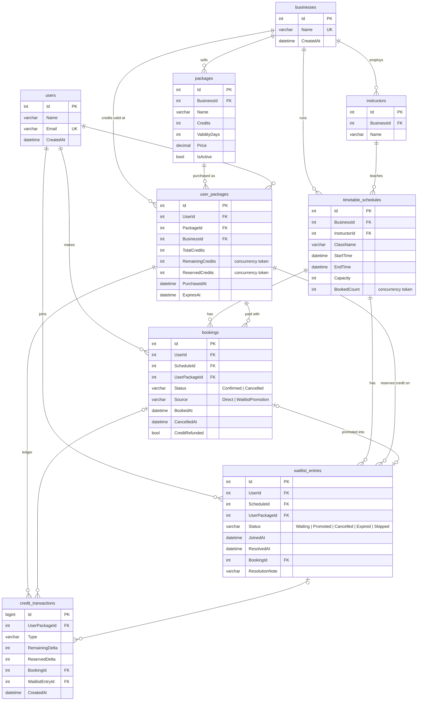

# Database schema

MySQL 8, managed with EF Core migrations (`src/Rezerv.Infrastructure/Persistence/Migrations`).
The full generated DDL is in [`schema.sql`](schema.sql). All timestamps are stored in UTC (`datetime(6)`).

## ERD



## Tables

| Table | Purpose |
|---|---|
| `businesses` | Studios. Everything else hangs off a business. |
| `users` | Customers. No auth in this exercise. |
| `instructors` | Belong to a business. |
| `packages` | The catalogue: what a business sells (credits, validity in days, price). |
| `user_packages` | A package a user bought. Holds the credit balance and the expiry date. `BusinessId` is copied from the package so the "same business" check doesn't need a join. |
| `timetable_schedules` | A single class occurrence. `Capacity` is the number of slots, `BookedCount` is the number of confirmed bookings. |
| `bookings` | One row per booking. Cancelled bookings are kept (status change, not delete). |
| `waitlist_entries` | FIFO queue per schedule. Rows are never deleted; the status records how the entry ended. |
| `credit_transactions` | Append-only ledger of every credit movement (purchase, debit, refund, reserve, release). |

## Credits model

```
RemainingCredits  = credits not spent yet
ReservedCredits   = credits held by Waiting waitlist entries
AvailableCredits  = RemainingCredits - ReservedCredits   (computed, what the user can spend)
```

| Event | Remaining | Reserved |
|---|---|---|
| Purchase | = total | 0 |
| Book | -1 | |
| Cancel > 4h before start | +1 | |
| Cancel within 4h | | |
| Join waitlist | | +1 |
| Promoted from waitlist | -1 | -1 |
| Leave waitlist / class ended / skipped | | -1 |

The sum of `credit_transactions` deltas for a package always equals its current balance, which
makes it easy to audit or rebuild balances.

## Constraints and indexes

Check constraints (the database refuses invalid states even if the app has a bug):

- `CK_schedules_booked`: `0 <= BookedCount <= Capacity` (no overbooking at DB level)
- `CK_user_packages_remaining`: `0 <= RemainingCredits <= TotalCredits`
- `CK_user_packages_reserved`: `0 <= ReservedCredits <= RemainingCredits`
- `CK_schedules_time`: `EndTime > StartTime`; `CK_schedules_capacity`: `Capacity > 0`
- `CK_packages_credits`, `CK_packages_validity`: positive values

Optimistic concurrency tokens: `timetable_schedules.BookedCount`, `user_packages.RemainingCredits`,
`user_packages.ReservedCredits`, `bookings.Status`, `waitlist_entries.Status`. EF adds them to the
`WHERE` clause of every `UPDATE`, so a write based on stale data affects 0 rows and is rejected.

Main indexes:

- `waitlist_entries (ScheduleId, Status, JoinedAt, Id)`: the "next in line" FIFO lookup
- `bookings (UserId, Status)`: overlap check and "my bookings"
- `bookings (ScheduleId, Status)`
- `timetable_schedules (BusinessId, StartTime)` and `(StartTime)`: timetable filters
- `user_packages (UserId, BusinessId, ExpiresAt)`: picking a package to pay with
- `credit_transactions (UserPackageId, CreatedAt)`
